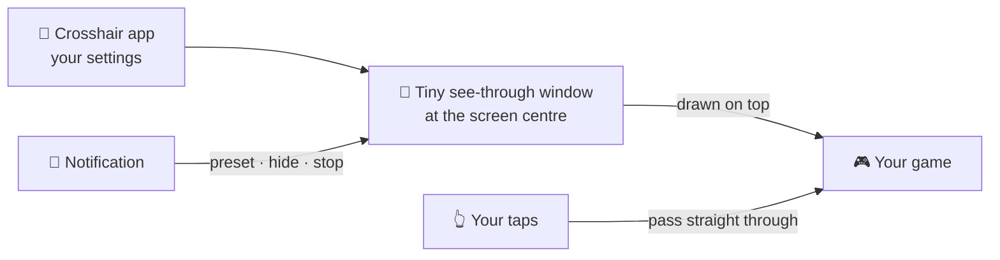

<h1 align="center">
  <br>
  <a href="https://github.com/Bensalk/crosshair"></a>
  <br>
  Crosshair
  <br>
</h1>

<h4 align="center">A steady aiming dot or cross in the middle of your screen for Android shooter games, without blocking your taps.</h4>

<p align="center">
  <a href="https://github.com/Bensalk/crosshair/releases"></a>
  
  
</p>

<p align="center">
  <a href="#-what-it-does">What it does</a> •
  <a href="#-get-started">Get started</a> •
  <a href="#-how-it-works">How it works</a> •
  <a href="#-faq-and-troubleshooting">FAQ</a> •
  <a href="#%EF%B8%8F-for-developers">For developers</a>
</p>

<p align="center"></p>

Crosshair is for players of COD Mobile, PUBG Mobile, Free Fire and other shooters who want a
clear aim point while hip-firing. It draws a crosshair on top of any app, and every tap still
reaches the game. Status: **stable** (1.0). One honest limit: games don't all aim at the exact
centre, so line it up once per game.

> [!NOTE]
> This repository is a copy of [Bensalk/crosshair](https://github.com/Bensalk/crosshair), made by
> Bensal. Downloads and updates come from that repository.

## ✨ What it does

- 🎯 **Seven styles** – Dot, Plus, Gap plus, T-shape, Circle, Ring + dot and X, with an optional
  centre dot.
- 🎨 **Any colour** – tap a swatch, slide to any colour, or type a hex code. Add a black or white
  outline so it shows on any map.
- 👆 **Taps pass through** – on Android 12 and newer, every tap reaches the game, never the
  crosshair.
- 📐 **Exact position** – move it 1 dp (a tiny screen step) at a time. Portrait and landscape keep
  their own position.
- 💾 **Three presets** – save setups for different weapons or modes, such as *Hipfire* and
  *Sniper*.
- 🔔 **Control it mid-match** – switch preset, hide it or stop it from the notification, or from a
  Quick Settings tile.
- 🔋 **Stays on** – comes back by itself if battery saver closes it, and uses little battery.
- 🔒 **Private** – no internet access at all, and no personal data stored.

<details>
<summary><b>Everything else</b></summary>

| Feature | Details |
| --- | --- |
| Size and look | Size, thickness, gap and opacity sliders; outline thickness |
| Position tools | **CENTER EXACTLY**, **FIT SIZE TO SCREEN** and centre guide lines |
| Backup | A file in `Download/Crosshair`, saved again each time you save a preset; restore from the file |
| Device card | Phone model, Android version, screen size and the exact crosshair position |
| Tablets | Two-column layout |
| In-app | Changelog and About |

</details>

## 📸 Screenshots

<table>
  <tr>
    <td align="center"><br><sub>Main screen</sub></td>
    <td align="center"><br><sub>Colour and style</sub></td>
    <td align="center"><br><sub>Position</sub></td>
  </tr>
  <tr>
    <td align="center"><br><sub>Presets</sub></td>
    <td align="center"><br><sub>On top of other apps</sub></td>
    <td align="center"><br><sub>Notification controls</sub></td>
  </tr>
</table>

<p align="center">
  <br>
  <sub>Running in landscape, as in a game</sub>
</p>

<p align="center"><br><sub>The seven styles</sub></p>

<sub>Screenshots are taken from the real app on Android emulators by the
[Screenshots workflow](.github/workflows/screenshots.yml).</sub>

## 🚀 Get started

### Step 1 – Download

| Your device | File to download | Works on |
| --- | --- | --- |
| 🤖 Android phone or tablet | `crosshair-v<version>.apk` from the [releases page](https://github.com/Bensalk/crosshair/releases) | Android 8.0 and newer |

Each release lists the APK's SHA-256 fingerprint and signing certificate, so you can check it is
genuine. Only install it from that releases page.

### Step 2 – Install

1. Open the downloaded `.apk` on your phone.
2. If Android asks, allow **Install unknown apps** for your browser or file manager. This is normal
   for apps from outside the Play Store.
3. Tap **Install**, then **Open**.

Newer versions install over the top and keep your settings and presets.

### Step 3 – First launch

1. Pick a **Style** and a **Color**, then set the size, thickness, gap and opacity. The preview
   shows the result.
2. Tap **▶ START OVERLAY**.
3. Android asks to **Display over other apps**: turn it on for Crosshair, then go back. Allow
   **Notifications** too.
4. If the app shows a battery banner, tap it and choose **Unrestricted**. This stops Android
   closing the crosshair mid-match.

### Step 4 – Line it up with your game

1. In **Position**, choose **LANDSCAPE** for games.
2. Open the game, then come back and move the crosshair with **+ / −** until it sits on the
   game's aim point. Hold a button to keep moving.
3. Tap **SAVE** on a preset slot and give it a name.
4. During a match, pull down the notification and use **Next preset**, **Hide / Show** or
   **Stop**.

The full guide, with backup and tips for FPS games, is in
[How to use Crosshair](docs/HOW-TO-USE.md).

## 🧭 How it works



- **The crosshair is a small window** drawn above every app, only as big as the crosshair.
- **It ignores touches.** Android passes every tap to the game underneath.
- **On Android 12 and newer** the window stays just under the system's touch limit (about 80%
  opacity). Above that, Android would block your taps, so the app caps the opacity there.
- **It cannot see your screen** or what you type, and it has no internet permission.

## 🔒 Your data

- **What it stores**: your crosshair settings and preset names, in the app's private storage.
  Nothing else.
- **What leaves the phone**: nothing. The app has no internet permission, and its data is left out
  of cloud backup and device transfer.
- **Back up**: ⋮ menu → **Backup** saves `Download/Crosshair/crosshair-backup.txt`. **Restore →
  CHOOSE BACKUP FILE** brings it back on a new phone.
- **Delete**: uninstall the app, then delete the `Download/Crosshair` folder if you made a backup.

<details>
<summary><b>Permissions, and why</b></summary>

| Permission | Why |
| --- | --- |
| Display over other apps | Draws the crosshair on top of the game |
| Notifications and foreground service | Keeps the crosshair running and shows Next preset, Hide and Stop |
| Ignore battery optimisation (optional) | Stops battery saver closing it mid-match |
| Storage (Android 8 and 9 only) | Saves the backup file to Downloads |

</details>

## ❓ FAQ and troubleshooting

<details>
<summary><b>The crosshair disappears in the middle of a match</b></summary>

Set battery use to **Unrestricted** (tap the battery banner in the app). On Xiaomi, Realme, Oppo or
Vivo phones, also turn on **Autostart** for Crosshair in App info. If Android does close it, the
crosshair comes back by itself.
</details>

<details>
<summary><b>"Display over other apps" is greyed out</b></summary>

Go to **App info → ⋮ menu → Allow restricted settings**, then try again. Android does this for
apps installed from outside the Play Store.
</details>

<details>
<summary><b>The opacity slider won't go fully solid</b></summary>

That's on purpose. Android blocks taps through overlays above about 80% opacity, so the app stops
there to keep your controls working.
</details>

<details>
<summary><b>The crosshair is slightly off from the game's aim point</b></summary>

Use **+ / −** in **Position** to move it 1 dp at a time while the game is open, then save a preset.
Landscape and portrait each keep their own position.
</details>

<details>
<summary><b>Is it allowed in games?</b></summary>

Crosshair only draws on the screen. It does not read or change the game. Each game has its own
rules, so check them if you are unsure.
</details>

## 🛠️ For developers

<details>
<summary>Build from source</summary>

You need JDK 17, Gradle 8.7 and the Android SDK 34.

```bash
cd CrosshairOverlay
gradle assembleRelease
```

- Every push builds a signed APK on GitHub Actions (`.github/workflows/build.yml`). A push to
  `main` that raises the version publishes a release. CI signs with the `KS_BASE64` and `KS_PASS`
  repository secrets.
- Source: `CrosshairOverlay/app/src/main/java/com/example/crosshair/`. Plain `android.widget`
  views built in code: no AndroidX, no Compose, no third-party libraries.
- Package `com.example.crosshair`, minSdk 26, targetSdk 34.
- The official signing certificate SHA-256 is
  `FA:AC:5C:90:39:EB:34:24:8C:F2:4C:78:F6:7F:46:82:4E:91:27:A4:0A:A0:7E:D0:0A:95:30:2F:E7:19:73:E5`.
  Android refuses updates signed with any other key, so a fake APK can't replace the real app.
- Changes per version: [CHANGELOG.md](CHANGELOG.md). Security: [SECURITY.md](SECURITY.md).

</details>

## Related

- [GST Calculator](https://github.com/Bensalk/gst-calculator) – Bensal's GST calculator for Android
  and Windows, in the same neon theme.

## License

Personal project by Bensal. All rights reserved. See [LICENSE](LICENSE).

---

> Original project [Bensalk/crosshair](https://github.com/Bensalk/crosshair)
